  

  
  
  

  <b>Four beautiful, animated README templates — drop one in, fill the blanks, stand out.</b> 
  No external services. The animations are hand-built SVG files, so they work even on private repos.

 

## 🎨 The templates

<table>
<tr>
<td width="50%" valign="top">

### 📦 [Library / Package](library/)
For a reusable library or package people install.

</td>
<td width="50%" valign="top">

### 🖥️ [Web App / SaaS](saas/)
For a product, web app, or SaaS.

</td>
</tr>
<tr>
<td width="50%" valign="top">

### ⌨️ [CLI Tool](cli/)
For a command-line tool.

</td>
<td width="50%" valign="top">

### 🎮 [Game / Mod](game/)
For a game, mod, or hobby project.

</td>
</tr>
</table>

 

## 🚀 How to use

1. **Pick a template** folder above.
2. **Copy** its `README.md` and `assets/` folder into your project.
3. **Find & replace** every `{{PLACEHOLDER}}` with your own details.
4. **Swap** the install commands / screenshots for real ones.
5. Delete the comment block at the top. Done.

> [!TIP]
> Every template uses the same animation style, so your projects look like a matching set.

## ✨ What's inside each one

| | Included |
|:-:|---|
| 🎬 | An animated hero banner |
| 🏷️ | Animated section headers |
| 🌊 | An animated footer |
| 📋 | A full README with fill-in-the-blank placeholders |
| ⚖️ | An MIT `LICENSE` |

## 📄 License

[MIT](LICENSE) © [Echo Vance](https://github.com/Dylgas) — use these in your own projects freely.

  

