<!--
  ╔══════════════════════════════════════════════════════════╗
  ║  CLI TOOL README TEMPLATE                                 ║
  ║  How to use: Replace {{PLACEHOLDERS}} and the demo        ║
  ║  commands, then delete this comment block.               ║
  ╚══════════════════════════════════════════════════════════╝
-->

<p align="center">
  
</p>

<p align="center">
  <a href="#"></a>
  <a href="#"></a>
  <a href="#-license"></a>
</p>

<p align="center">
  <b>{{ONE_LINE_PITCH}}</b><br>
  <sub>Fast · Scriptable · Zero config</sub>
</p>

<p align="center">
  <a href="#-installation">Install</a> •
  <a href="#-commands">Commands</a> •
  <a href="#-configuration">Config</a> •
  <a href="#-examples">Examples</a>
</p>

<br>


<details open>
<summary><b>🍺 Homebrew (macOS / Linux)</b></summary>

```bash
brew install {{CLI_NAME}}
```
</details>

<details>
<summary><b>📦 npm</b></summary>

```bash
npm install -g {{CLI_NAME}}
```
</details>

<details>
<summary><b>⚡ curl (one-liner)</b></summary>

```bash
curl -fsSL https://{{INSTALL_URL}} | sh
```
</details>

<details>
<summary><b>🪟 Windows (Scoop)</b></summary>

```powershell
scoop install {{CLI_NAME}}
```
</details>

Verify it worked:

```bash
{{CLI_NAME}} --version
```

<br>


```bash
{{CLI_NAME}} <command> [options]
```

| Command | Description |
|---|---|
| `{{CLI_NAME}} init` | {{CMD_INIT_DESC}} |
| `{{CLI_NAME}} build` | {{CMD_BUILD_DESC}} |
| `{{CLI_NAME}} deploy` | {{CMD_DEPLOY_DESC}} |
| `{{CLI_NAME}} status` | {{CMD_STATUS_DESC}} |

### Global flags

| Flag | Short | Description |
|---|:-:|---|
| `--help` | `-h` | Show help |
| `--version` | `-v` | Print version |
| `--verbose` | | Extra output |
| `--json` | | Machine-readable output |

<br>


{{CLI_NAME}} reads config from `{{CONFIG_FILE}}`:

```yaml
# {{CONFIG_FILE}}
{{CONFIG_KEY_1}}: value
{{CONFIG_KEY_2}}: true
```

> [!TIP]
> Any config value can be overridden with a flag or an environment variable.

<br>

## 💡 Examples

```bash
# {{EXAMPLE_1_DESC}}
{{CLI_NAME}} init my-app

# {{EXAMPLE_2_DESC}}
{{CLI_NAME}} deploy --prod --json

# Pipe output to other tools
{{CLI_NAME}} status --json | jq '.healthy'
```

## 🔧 Shell completions

<details>
<summary><b>Enable tab completion</b></summary>

```bash
# zsh
{{CLI_NAME}} completion zsh > "${fpath[1]}/_{{CLI_NAME}}"

# bash
{{CLI_NAME}} completion bash > /etc/bash_completion.d/{{CLI_NAME}}
```
</details>

## 📄 License

[MIT](LICENSE) © [{{AUTHOR}}](https://github.com/{{USER}})

<p align="center">
  
</p>
