<!--
  ╔══════════════════════════════════════════════════════════╗
  ║  LIBRARY / PACKAGE README TEMPLATE                        ║
  ║  How to use: Find & replace {{PLACEHOLDERS}} below, swap  ║
  ║  the install command, and delete this comment block.     ║
  ╚══════════════════════════════════════════════════════════╝
-->

<p align="center">
  
</p>

<p align="center">
  <a href="https://www.npmjs.com/package/{{PACKAGE}}"></a>
  <a href="#"></a>
  <a href="#"></a>
  <a href="#-license"></a>
</p>

<p align="center">
  <b>{{ONE_LINE_PITCH}}</b><br>
  <sub>Typed · Tree-shakeable · Zero dependencies · Works everywhere</sub>
</p>

<p align="center">
  <a href="#-installation">Install</a> •
  <a href="#-usage">Usage</a> •
  <a href="#-api">API</a> •
  <a href="#-examples">Examples</a> •
  <a href="#-contributing">Contribute</a>
</p>

<br>


```bash
# npm
npm install {{PACKAGE}}

# pnpm
pnpm add {{PACKAGE}}

# yarn
yarn add {{PACKAGE}}

# bun
bun add {{PACKAGE}}
```

> [!TIP]
> No build step required. Import and go.

<br>


```ts
import { {{MAIN_FUNCTION}} } from "{{PACKAGE}}";

const result = {{MAIN_FUNCTION}}("hello");
console.log(result); // → "..."
```

### Why {{LIB_NAME}}?

| | | |
|:-:|---|---|
| ⚡ | **Fast** | {{BENEFIT_SPEED}} |
| 🪶 | **Tiny** | {{BENEFIT_SIZE}} |
| 🛡️ | **Typed** | Full TypeScript types, no `@types` package needed |
| 🌲 | **Tree-shakeable** | Only ship what you use |

<br>


### `{{MAIN_FUNCTION}}(input, options?)`

Describe what it does in one sentence.

| Parameter | Type | Default | Description |
|---|---|---|---|
| `input` | `string` | — | {{PARAM_1_DESC}} |
| `options.{{OPT}}` | `boolean` | `false` | {{PARAM_2_DESC}} |

**Returns** `{{RETURN_TYPE}}` — {{RETURN_DESC}}

```ts
{{MAIN_FUNCTION}}("input", { {{OPT}}: true });
```

<details>
<summary><b>More methods</b></summary>
<br>

| Method | Description |
|---|---|
| `{{METHOD_A}}()` | {{METHOD_A_DESC}} |
| `{{METHOD_B}}()` | {{METHOD_B_DESC}} |

</details>

<br>

## 💡 Examples

<details open>
<summary><b>Basic</b></summary>

```ts
import { {{MAIN_FUNCTION}} } from "{{PACKAGE}}";
{{MAIN_FUNCTION}}("example");
```
</details>

<details>
<summary><b>With a framework</b></summary>

```tsx
// Works in React, Vue, Svelte, Node — anywhere.
const value = {{MAIN_FUNCTION}}(input);
```
</details>

## 📊 Comparison

| | {{LIB_NAME}} | Alternative A | Alternative B |
|---|:-:|:-:|:-:|
| Size | **2.4 kB** | 18 kB | 9 kB |
| Dependencies | **0** | 4 | 1 |
| TypeScript | ✅ | ⚠️ | ✅ |
| Tree-shaking | ✅ | ❌ | ✅ |

<br>

## 🤝 Contributing

Contributions welcome! See [`CONTRIBUTING.md`](CONTRIBUTING.md).

```bash
git clone https://github.com/{{USER}}/{{REPO}}.git
cd {{REPO}} && npm install && npm test
```

## 📄 License

[MIT](LICENSE) © [{{AUTHOR}}](https://github.com/{{USER}})

<p align="center">
  
</p>
