<!--
  ╔══════════════════════════════════════════════════════════╗
  ║  WEB APP / SAAS README TEMPLATE                           ║
  ║  How to use: Replace {{PLACEHOLDERS}}, drop a real        ║
  ║  screenshot into assets/, delete this comment block.     ║
  ╚══════════════════════════════════════════════════════════╝
-->

<p align="center">
  
</p>

<p align="center">
  <a href="{{LIVE_URL}}"></a>
  <a href="#"></a>
  <a href="{{DOCS_URL}}"></a>
</p>

<p align="center">
  <b>{{ONE_LINE_PITCH}}</b><br>
  <sub>{{TAGLINE}}</sub>
</p>

<p align="center">
  <a href="#-features">Features</a> •
  <a href="#-screenshots">Screenshots</a> •
  <a href="#-tech-stack">Stack</a> •
  <a href="#-getting-started">Get started</a> •
  <a href="#-pricing">Pricing</a>
</p>

<br>



| | Feature | What it does |
|:-:|---|---|
| ⚡ | **{{FEATURE_1}}** | {{FEATURE_1_DESC}} |
| 🔒 | **{{FEATURE_2}}** | {{FEATURE_2_DESC}} |
| 📊 | **{{FEATURE_3}}** | {{FEATURE_3_DESC}} |
| 🔗 | **{{FEATURE_4}}** | {{FEATURE_4_DESC}} |
| 🌙 | **{{FEATURE_5}}** | {{FEATURE_5_DESC}} |
| 🚀 | **{{FEATURE_6}}** | {{FEATURE_6_DESC}} |

<br>

## 📸 Screenshots

<!-- TODO: Replace these placeholders with real screenshots in assets/ -->
<p align="center">
  
  
</p>

<br>



<p align="center">
  
</p>

```mermaid
flowchart LR
    U([User]) --> CDN[CDN] --> APP[{{APP_NAME}}]
    APP --> API[API] --> DB[(Database)]
    API --> CACHE[(Cache)]
    API --> Q[[Jobs]]
```

<br>

## 🚀 Getting Started

```bash
git clone https://github.com/{{USER}}/{{REPO}}.git
cd {{REPO}}
cp .env.example .env    # add your keys
npm install
npm run dev             # → http://localhost:3000
```

> [!NOTE]
> See [`.env.example`](.env.example) for every setting you'll need.

### Deploy

<p>
  <a href="#"></a>
  <a href="#"></a>
  <a href="#"></a>
</p>

<br>


| | **Free** | **Pro** | **Team** |
|---|:-:|:-:|:-:|
| Price | $0 | ${{PRO_PRICE}}/mo | ${{TEAM_PRICE}}/mo |
| {{LIMIT_NAME}} | {{FREE_LIMIT}} | {{PRO_LIMIT}} | Unlimited |
| Support | Community | Email | Priority |
| | | **Most popular** | |

<br>

## 🗺️ Roadmap

- [x] {{DONE_1}}
- [x] {{DONE_2}}
- [ ] {{PLANNED_1}}
- [ ] {{PLANNED_2}}

## 📄 License

{{LICENSE}} © [{{AUTHOR}}](https://github.com/{{USER}})

<p align="center">
  
</p>
